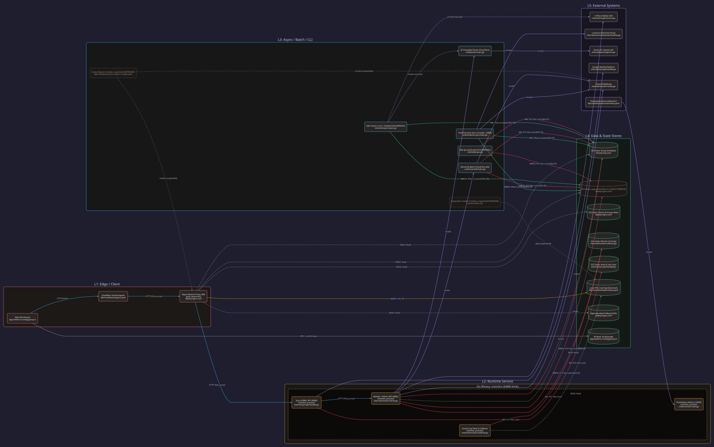
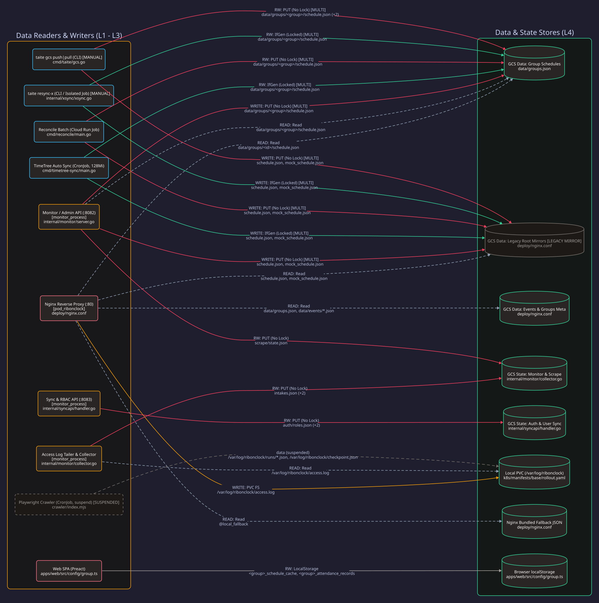

# システム構成・データ経路リファレンス

本ドキュメントは [system-graph.yaml](system-graph.yaml)（記述規約: [system-graph-rules.md](system-graph-rules.md)）から自動生成されています。手動編集せず `node scripts/gen-system-graph.mjs --render` を実行してください。

## 1. 全体構成ビュー (L1 - L5)

## 2. データ読み書き・排他制御ビュー (`kind: data`)

## 3. 書き込み経路マトリクス（Store 逆引き）

| Store | Actor | Op | Concurrency | Multi-Target | Status | Entry | Targets |
|---|---|---|---|---|---|---|---|
| `browser_local_storage` (Browser localStorage) | `web_spa` (Web SPA (Preact)) | `rw` | `client_local` | no | `active` | `apps/web/src/config/group.ts` | `<group>_schedule_cache`, `<group>_attendance_records` |
| `local_pvc` (Local PVC (/var/log/ribonclock)) | `nginx_proxy` (Nginx Reverse Proxy (:80)) | `write` | `shared_pvc_single` | no | `active` | `deploy/nginx.conf` | `/var/log/ribonclock/access.log` |
| `gcs_state_monitor` (GCS State: Monitor & Scrape) | `log_tailer` (Access Log Tailer & Collector) | `rw` | `none_put` | no | `active` | `internal/monitor/collector.go#persistIntakesLocked` | `intakes.json`, `pipeline_state.json`, `activities.json` |
| `gcs_data_groups` (GCS Data: Group Schedules) | `monitor_api` (Monitor / Admin API (:8082)) | `write` | `none_put` | yes | `active` | `internal/monitor/server.go#writeGroupSchedule` | `data/groups/<group>/schedule.json` |
| `gcs_data_mirrors` (GCS Data: Legacy Root Mirrors) | `monitor_api` (Monitor / Admin API (:8082)) | `write` | `none_put` | yes | `legacy_mirror` | `internal/monitor/server.go#writeGroupSchedule` | `schedule.json`, `mock_schedule.json` |
| `gcs_state_monitor` (GCS State: Monitor & Scrape) | `monitor_api` (Monitor / Admin API (:8082)) | `rw` | `none_put` | no | `active` | `internal/monitor/server.go#scrapeStateStore` | `scrape/state.json` |
| `gcs_state_auth` (GCS State: Auth & User Sync) | `sync_api` (Sync & RBAC API (:8083)) | `rw` | `none_put` | no | `active` | `internal/syncapi/handler.go#handleSyncData` | `auth/roles.json`, `auth/cookie_secret.json`, `users/<sha256(uid)>/sync.json` |
| `gcs_data_groups` (GCS Data: Group Schedules) | `timetree_sync` (TimeTree Auto Sync (CronJob, 128Mi)) | `rw` | `generation_lock` | yes | `active` | `internal/timetreesync/sync.go#Run` | `data/groups/<group>/schedule.json` |
| `gcs_data_mirrors` (GCS Data: Legacy Root Mirrors) | `timetree_sync` (TimeTree Auto Sync (CronJob, 128Mi)) | `write` | `generation_lock` | yes | `legacy_mirror` | `internal/timetreesync/sync.go#readMirrors` | `schedule.json`, `mock_schedule.json` |
| `gcs_data_groups` (GCS Data: Group Schedules) | `taite_reconcile` (Reconcile Batch (Cloud Run Job)) | `rw` | `none_put` | yes | `active` | `internal/reconcile/runner.go#Run` | `data/groups/<group>/schedule.json` |
| `gcs_data_mirrors` (GCS Data: Legacy Root Mirrors) | `taite_reconcile` (Reconcile Batch (Cloud Run Job)) | `write` | `none_put` | yes | `legacy_mirror` | `internal/reconcile/runner.go#Run` | `schedule.json`, `mock_schedule.json` |
| `gcs_data_groups` (GCS Data: Group Schedules) | `taite_resync_x` (taite resync-x (CLI / Isolated Job)) | `rw` | `generation_lock` | yes | `manual` | `internal/xsync/xsync.go#RunGCSGroup` | `data/groups/<group>/schedule.json` |
| `gcs_data_mirrors` (GCS Data: Legacy Root Mirrors) | `taite_resync_x` (taite resync-x (CLI / Isolated Job)) | `write` | `generation_lock` | yes | `legacy_mirror` | `internal/xsync/xsync.go#RunGCSGroup` | `schedule.json`, `mock_schedule.json` |
| `gcs_data_groups` (GCS Data: Group Schedules) | `taite_gcs_cli` (taite gcs push|pull (CLI)) | `rw` | `none_put` | yes | `manual` | `cmd/taite/gcs.go#gcsPush` | `data/groups/<group>/schedule.json`, `data/groups.json`, `data/events/*.json` |
| `gcs_data_mirrors` (GCS Data: Legacy Root Mirrors) | `taite_gcs_cli` (taite gcs push|pull (CLI)) | `write` | `none_put` | yes | `legacy_mirror` | `cmd/taite/gcs.go#gcsPush` | `schedule.json`, `mock_schedule.json` |
| `local_pvc` (Local PVC (/var/log/ribonclock)) | `crawler_cron` (Playwright Crawler (CronJob, suspend)) | `rw` | `shared_pvc_single` | no | `suspended` | `crawler/index.mjs` | `/var/log/ribonclock/runs/*.json`, `/var/log/ribonclock/checkpoint.json` |

## 4. 同居グループ (`host_groups`)

| ID | Label | Parent | Entry | Notes |
|---|---|---|---|---|
| `pod_ribonclock` | K8s Rollout Pod (ribonclock) | - | `k8s/manifests/base/rollout.yaml` | web (Nginx) と monitor の 2 コンテナが同一 Pod・同一 Ingress 配下で同居する |
| `monitor_process` | Go Binary: monitor (64Mi limit) | `pod_ribonclock` | `cmd/monitor/main.go` | :8082 (monitor_api), :8083 (sync_api), :9090 (metrics), log_tailer を 1 プロセス・64Mi 上限内で共有 |
